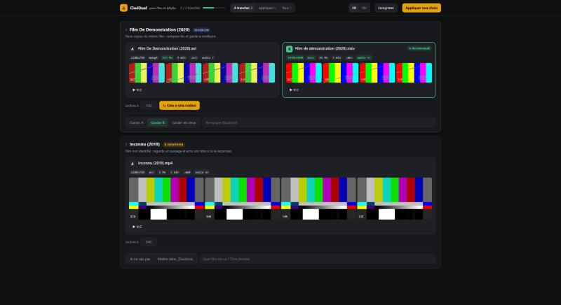

# ⚔ CinéDuel

**Compare tes doublons de films pour Plex et Jellyfin.**

[English](README.md) · **Français**

Tu as plusieurs copies du même film ? Cette petite page t'aide à **choisir la meilleure** et à ranger ta bibliothèque Plex (ou Jellyfin).



## Ce qu'il fait

- 🔎 **Trouve les doublons** : deux fichiers avec le même titre et la même année (`Titre (Année).mkv`), même écrits un peu différemment.
- 📋 **Montre les infos** de chaque copie : résolution, codec, taille, durée, langues. La meilleure valeur est en **vert**.
- ★ **Recommande une copie** selon des règles claires. Si les pistes audio sont les mêmes, la meilleure résolution gagne. Sinon, il préfère un format récent à un `.avi`, puis une piste française, puis la résolution. La taille est comparée de façon juste : un fichier HEVC compte double, un AV1 compte 2,5 fois.
- 🖼️ **Captures d'écran au même instant** pour les deux copies. Clique dessus pour les voir en **plein écran** :
  - `←` `→` : instant suivant
  - `Espace` : passer de A à B (le plus parlant pour voir la netteté)
  - `S` : les deux côte à côte
  - `Échap` : fermer
- ▶️ **Ouvre chaque copie dans VLC** au moment que tu veux.
- ⇆ **Côte à côte vidéo** : les deux films dans une seule fenêtre, synchronisés.
- ✅ **Bouton « Appliquer mes choix »** : la copie que tu ne gardes pas va dans un dossier `_Doublons`. **Rien n'est jamais supprimé** : tu vides `_Doublons` toi-même quand tu veux.
- ✏️ **Films inconnus** : écris le vrai titre (`Wall Street (1987)`) et le fichier est renommé. Si ce film existe déjà, il devient un nouveau doublon à comparer.
- 🌍 **Français et anglais** : change de langue avec les boutons `FR` / `EN` en haut.

Tout se passe **sur ton ordinateur**. Rien n'est envoyé sur Internet.

---

## 🧸 Installer (très facile, promis)

Il faut 3 choses : **Python**, **ffmpeg** et **VLC**. On les installe une seule fois.

### 1. Ouvre la boîte magique 🪄

- Appuie sur la touche **Windows** ⊞ du clavier.
- Écris **`terminal`**.
- Appuie sur **Entrée** ↵.

Une fenêtre noire (ou bleue) s'ouvre. C'est la boîte magique : on lui écrit des phrases et elle installe tout toute seule.

### 2. Donne-lui les 3 phrases 🗣️

Copie **une** phrase, colle-la dans la fenêtre (clic droit, ou `Ctrl` + `V`), puis appuie sur **Entrée** ↵. Attends qu'elle ait fini, puis passe à la suivante.

```
winget install Python.Python.3.12
```

```
winget install Gyan.FFmpeg
```

```
winget install VideoLAN.VLC
```

Si elle te pose une question, écris **`O`** (ou **`Y`**) puis **Entrée** ↵ : ça veut dire « oui ».

Ensuite **ferme** la fenêtre. C'est fini pour l'installation ! 🎉

### 3. Récupère CinéDuel 📦

- Tout en haut de cette page GitHub, clique sur le bouton vert **`<> Code`**.
- Clique sur **`Download ZIP`**.
- Va dans tes **Téléchargements**, fais un clic droit sur le fichier ZIP, puis **`Extraire tout…`** et **`Extraire`**.

Tu as maintenant un dossier **`cineduel-main`**. 📁

### 4. Lance-le ▶️

- Ouvre le dossier `cineduel-main`.
- Double-clique sur **`CineDuel.bat`**.
- Il te demande où sont tes films : écris le chemin du dossier (par exemple **`D:\Films`**), puis **Entrée** ↵.

Astuce : dans l'Explorateur, clique sur la barre d'adresse en haut du dossier de tes films, copie le chemin et colle-le.

La page s'ouvre toute seule dans ton navigateur. 🥳
Si elle ne s'ouvre pas, va sur **http://127.0.0.1:8770**.

Pour arrêter, ferme la fenêtre noire.

---

## Pour aller plus loin

### Tes films doivent être nommés « à la Plex »

```
Titre (Année).mkv
Le Fabuleux Destin d'Amélie Poulain (2001).mkv
Alien (1979) {edition-Director's Cut}.mkv      ← une édition : jamais prise pour un doublon
```

Un film peut aussi être dans son propre dossier : `Titre (Année)\Titre (Année).mkv`.

### Lancer à la main

```
python -I trouver_doublons.py "D:\Films"
python -I cineduel.py --cas "D:\Films\_choix_a_faire.json" --choix "D:\Films\_mes_choix.json"
```

| Option | Rôle |
|---|---|
| `--port 8770` | changer le port de la page |
| `--racine <dossier>` | bibliothèque (par défaut : le dossier du fichier `--cas`) |
| `--appliquer` | appliquer les choix enregistrés sans ouvrir la page |

### Ajouter tes propres cas

`_choix_a_faire.json` est une simple liste. Une paire a `a` et `b` ; un film à identifier n'a que `a` :

```json
[
  {"id": "0", "titre": "Alien (1979)", "a": "D:\\Films\\Alien (1979).mkv", "b": "D:\\Films\\Alien (1979).avi", "type": "doublon", "note": ""},
  {"id": "1", "titre": "Inconnu (2019)", "a": "D:\\Films\\Inconnu (2019).mp4", "type": "ident", "note": ""}
]
```

Laisse `note` vide pour afficher l'explication intégrée dans la langue choisie, ou écris ton propre texte.

### Quand on applique les choix

- La copie écartée va dans `<bibliothèque>\_Doublons`. Si le nom existe déjà, elle devient `Nom [2].mkv`.
- La copie gardée prend le nom le plus propre des deux (accents, tirets…).
- Un dossier de film sans sous-titres est remplacé par le fichier seul.
- Chaque opération est notée dans `<bibliothèque>\_journal_renommage_plex.csv` (ancien chemin, nouveau chemin, date).

### Les fichiers

| Fichier | Rôle |
|---|---|
| `cineduel.py` | la page et son petit serveur local |
| `trouver_doublons.py` | cherche les doublons et prépare la liste |
| `resolution.py`, `langues.py`, `duree.py`, `codec.py` | lisent les infos des vidéos si `ffprobe` est absent |
| `CineDuel.bat` | le lanceur à double-cliquer |

## Licence

CinéDuel est un projet indépendant, sans lien avec Plex Inc. ni Jellyfin.


MIT : tu peux l'utiliser, le modifier et le partager librement.
