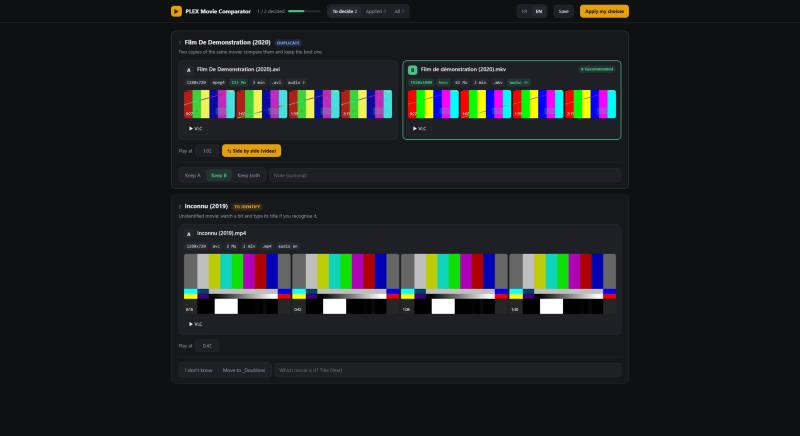

# 🎬 PLEX Movie Comparator

**English** · [Français](README.fr.md)

Got several copies of the same movie? This little page helps you **pick the best one** and tidy up your Plex (or Jellyfin) library.



## What it does

- 🔎 **Finds duplicates**: two files with the same title and year (`Title (Year).mkv`), even if they are written a bit differently.
- 📋 **Shows the details** of each copy: resolution, codec, size, duration, audio languages. The better value is shown in **green**.
- ★ **Recommends a copy** using clear rules: if the audio tracks are the same, the higher resolution wins. Otherwise it prefers a modern format over `.avi`, then French audio, then resolution. Size is compared fairly: an HEVC file counts double, an AV1 file 2.5 times.
- 🖼️ **Screenshots at the same moments** for both copies. Click one to see it **full screen**:
  - `←` `→`: next moment
  - `Space`: switch between A and B (the best way to judge sharpness)
  - `S`: both side by side
  - `Esc`: close
- ▶️ **Opens each copy in VLC** at the moment you choose.
- ⇆ **Side-by-side video**: both movies in one window, in sync.
- ✅ **"Apply my choices" button**: the copy you don't keep is moved to a `_Doublons` folder. **Nothing is ever deleted**: you empty `_Doublons` yourself, whenever you want.
- ✏️ **Unknown movies**: type the real title (`Wall Street (1987)`) and the file is renamed. If that movie already exists, it becomes a new duplicate to compare.
- 🌍 **French and English**: switch with the `FR` / `EN` buttons at the top.

Everything stays **on your computer**. Nothing is sent to the Internet.

---

## 🧸 Install it (very easy, promise)

You need 3 things: **Python**, **ffmpeg** and **VLC**. You only install them once.

### 1. Open the magic box 🪄

- Press the **Windows** key ⊞ on your keyboard.
- Type **`terminal`**.
- Press **Enter** ↵.

A black (or blue) window opens. That's the magic box: you type sentences into it and it installs everything by itself.

### 2. Give it the 3 sentences 🗣️

Copy **one** sentence, paste it into the window (right-click, or `Ctrl` + `V`), then press **Enter** ↵. Wait until it's done, then move on to the next one.

```
winget install Python.Python.3.12
```

```
winget install Gyan.FFmpeg
```

```
winget install VideoLAN.VLC
```

If it asks you a question, type **`Y`** and press **Enter** ↵: it means "yes".

Then **close** the window. Installation done! 🎉

### 3. Get the comparator 📦

- At the top of this GitHub page, click the green **`<> Code`** button.
- Click **`Download ZIP`**.
- Go to your **Downloads**, right-click the ZIP file, then **`Extract All…`** and **`Extract`**.

You now have a **`comparateur-films-plex`** folder. 📁

### 4. Start it ▶️

- Open the `comparateur-films-plex` folder.
- Double-click **`lancer.bat`** ("lancer" means "start").
- It asks where your movies are: type the folder path (for example **`D:\Movies`**), then **Enter** ↵.

Tip: in File Explorer, click the address bar at the top of your movies folder, copy the path and paste it.

The page opens by itself in your browser. 🥳
If it doesn't, go to **http://127.0.0.1:8770**.

To stop, close the black window.

---

## Going further

### Your movies must be named "the Plex way"

```
Title (Year).mkv
Amélie (2001).mkv
Alien (1979) {edition-Director's Cut}.mkv      ← an edition: never treated as a duplicate
```

A movie can also live in its own folder: `Title (Year)\Title (Year).mkv`.

### Run it by hand

```
python -I trouver_doublons.py "D:\Movies"
python -I comparateur.py --cas "D:\Movies\_choix_a_faire.json" --choix "D:\Movies\_mes_choix.json"
```

| Option | What it does |
|---|---|
| `--port 8770` | change the page port |
| `--racine <folder>` | the library (default: the folder of the `--cas` file) |
| `--appliquer` | apply the saved choices without opening the page |

### Add your own cases

`_choix_a_faire.json` is a simple list. A pair has `a` and `b`; a movie to identify only has `a`:

```json
[
  {"id": "0", "titre": "Alien (1979)", "a": "D:\\Movies\\Alien (1979).mkv", "b": "D:\\Movies\\Alien (1979).avi", "type": "doublon", "note": ""},
  {"id": "1", "titre": "Unknown (2019)", "a": "D:\\Movies\\Unknown (2019).mp4", "type": "ident", "note": ""}
]
```

Leave `note` empty to get the built-in explanation in the chosen language, or write your own text.

### When choices are applied

- The discarded copy goes to `<library>\_Doublons`. If the name is already taken there, it becomes `Name [2].mkv`.
- The kept copy takes the cleaner of the two names (accents, dashes…).
- A movie folder without subtitles is replaced by the file alone.
- Every operation is logged in `<library>\_journal_renommage_plex.csv` (old path, new path, date).

### Files

| File | Role |
|---|---|
| `comparateur.py` | the page and its small local server |
| `trouver_doublons.py` | finds duplicates and prepares the list |
| `resolution.py`, `langues.py`, `duree.py`, `codec.py` | read video details when `ffprobe` is missing |
| `lancer.bat` | the double-click launcher |

## License

MIT: you can use, modify and share it freely.
